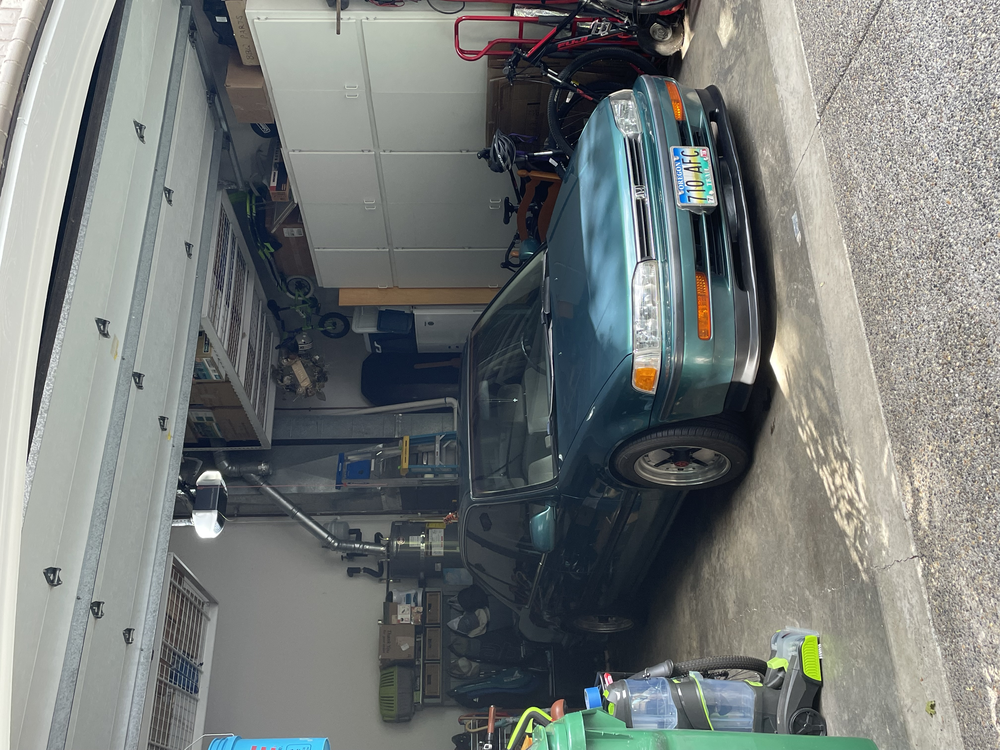
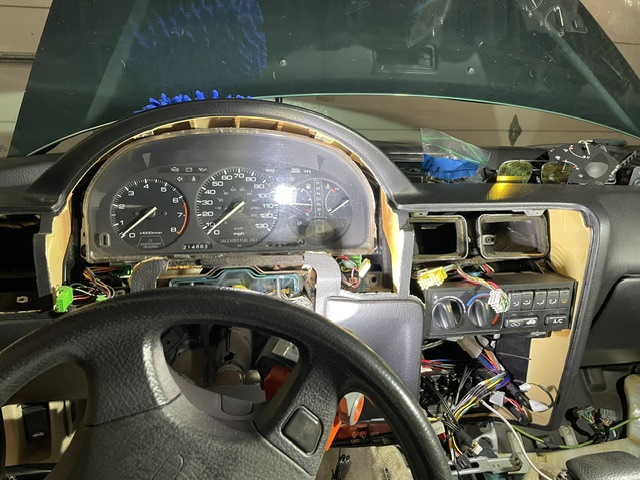
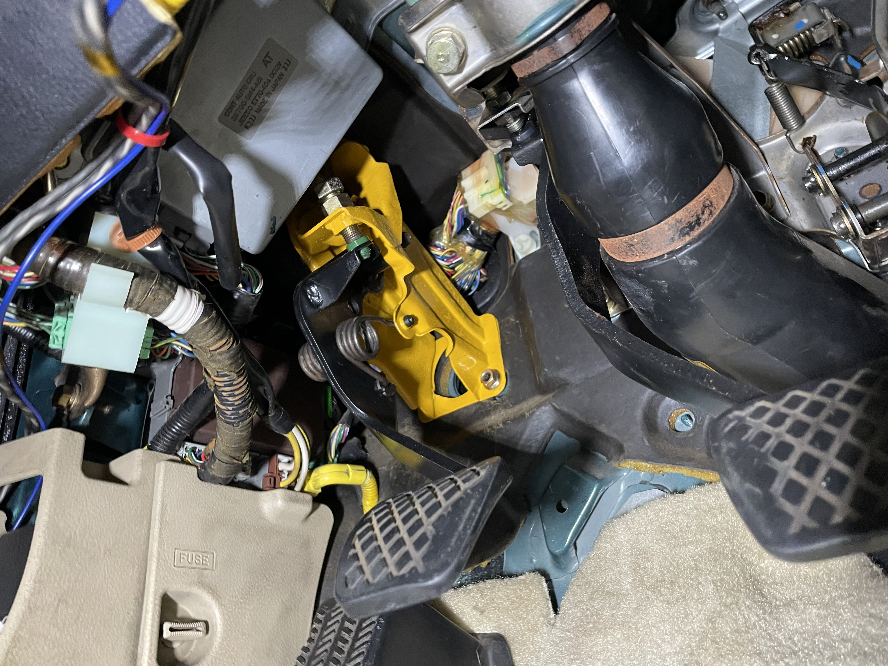
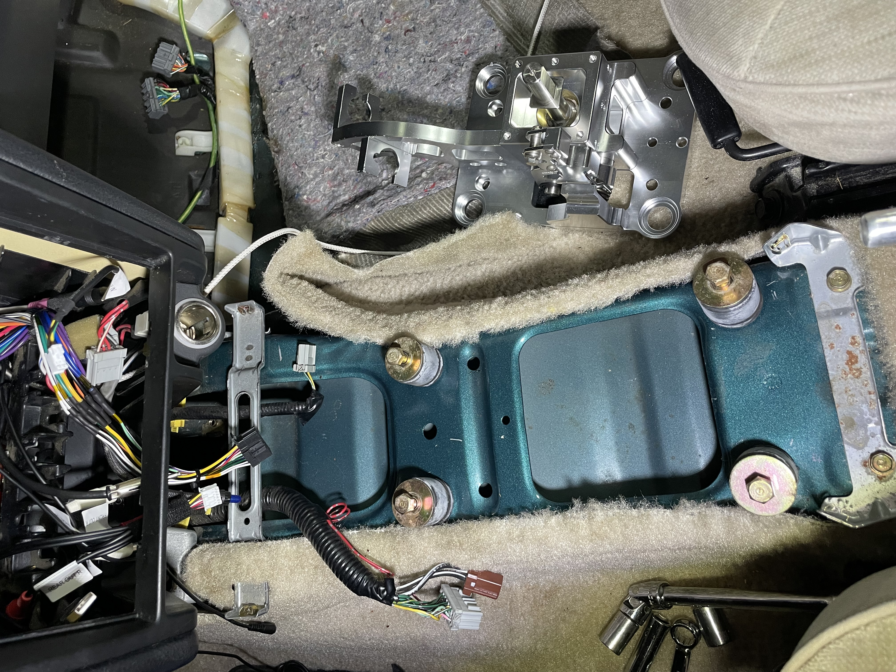
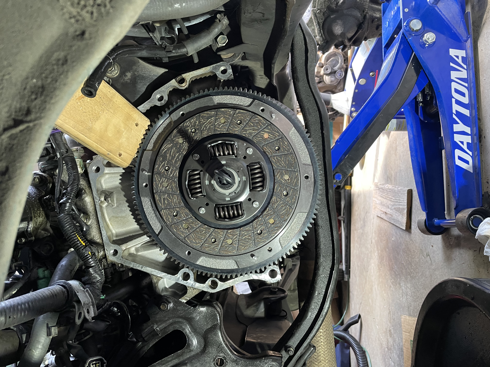
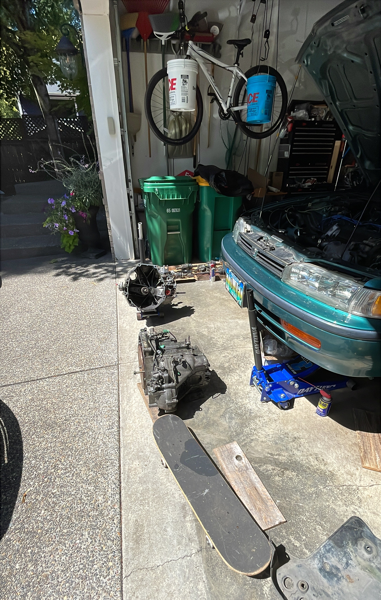
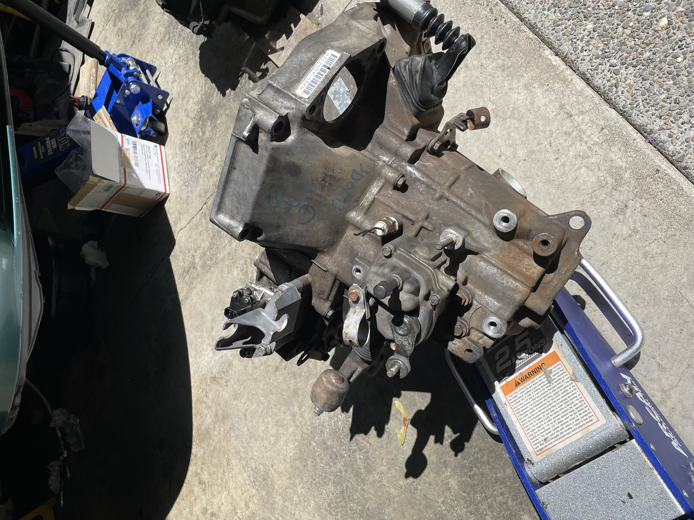
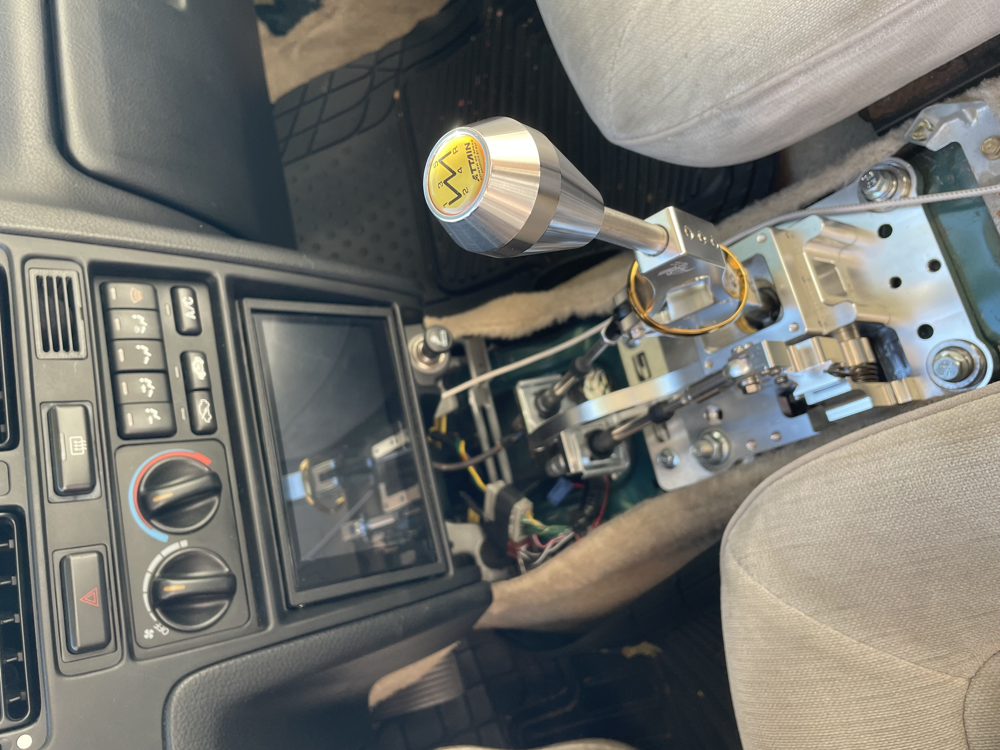

My first car, a 1992 Honda Accord that my Grandpa bought new off the lot has taught me so many things, including how to do a transmission swap in my parent's garage with a basic toolbox.

This car was already on its second 4-speed automatic transmission, and during the previous winter it started having issues shifting out of 1st gear. Combine that with the impressively slow 3-2 shift and 3rd gear slipping, I thought a manual transmission swap would be a great way to make the car both more reliable was well as more engaging.

_1992 Honda Accord, CB7._

Using a rough guide found in an online forum and a few handy YouTube videos, a spreadsheet for parts tracking, a few trips to the junkyard and an eBay transmission, the transmission swap went smoothly! Here are some pictures of the process.

_A thorough teardown to change the automatic gear selector lights._

_Junkyard clutch pedal assmebly refreshed and installed, with 3D printed TPU end stops._

_Couldn't resist a shiny billet shift box._

_New clutch and manual flywheel, don't get to see that often!_

_Out with the old, in with the new._

_Another look at the manual transmission, all cleaned up. During this time, I had to modify the new transmission mount as the fitment from the manufacturer was off!_

_An imported shift knob from Japan is the cherry on top._

I've put a few thousand miles on this swap so far! I did encounter hiccups with the cheap clutch master and shift cables having manufacturer defects. Once those were sorted, the swap has been an amazing upgrade.

## Extra Upgrades
* TPU shift cable grommet through the exhaust tunnel
* TPU clutch pedal bumpers
* Reverse light wiring
* Head unit microphone mount integrated into dash
* Machined shift cable end link to correct manufacturer defect

## What I Learned
This project was a thorough immersion of an intense automotive project. There were so many parts to keep track of and things to do, and I found success in having a physical list with notes on what was removed or installed. A spreadsheet including part ordered and recieved dates was also very helpful.