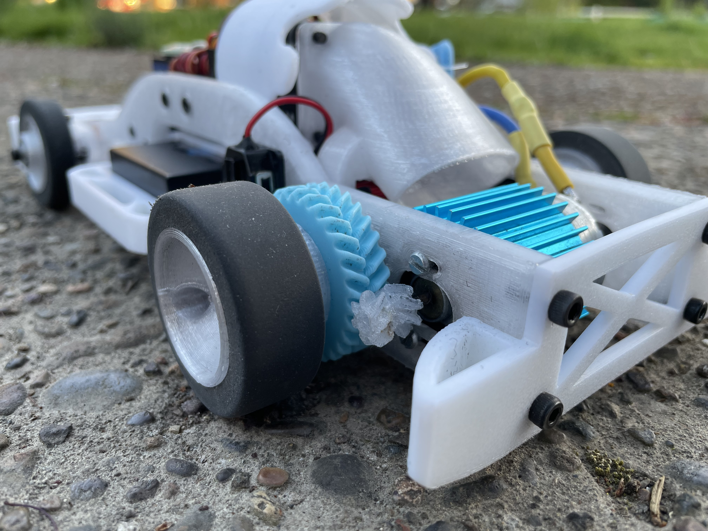
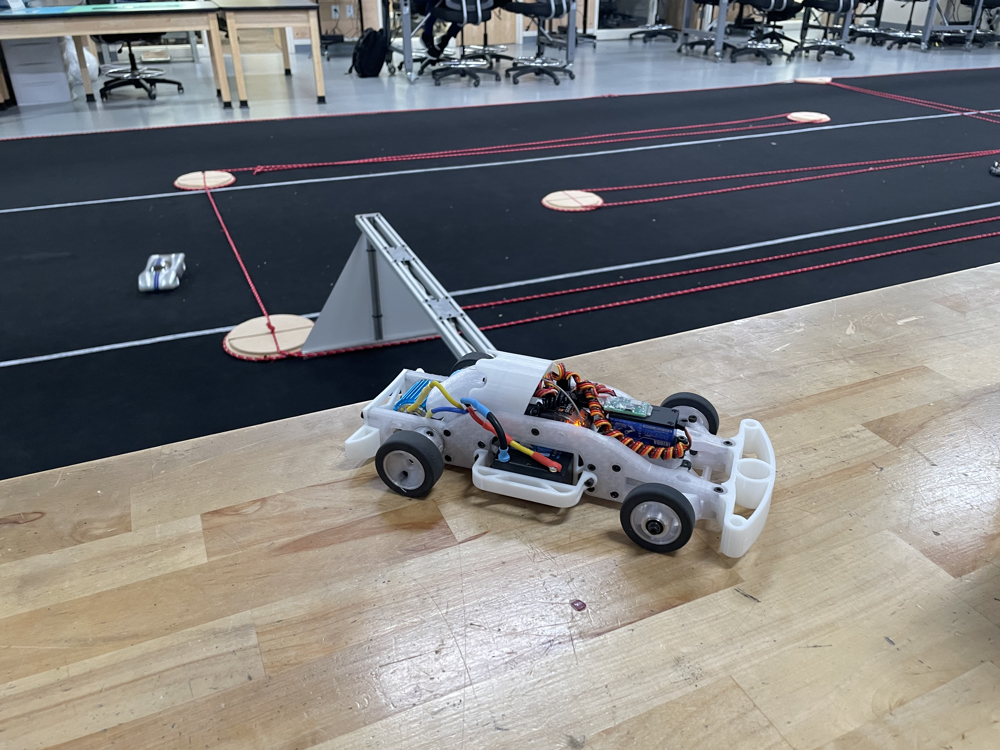
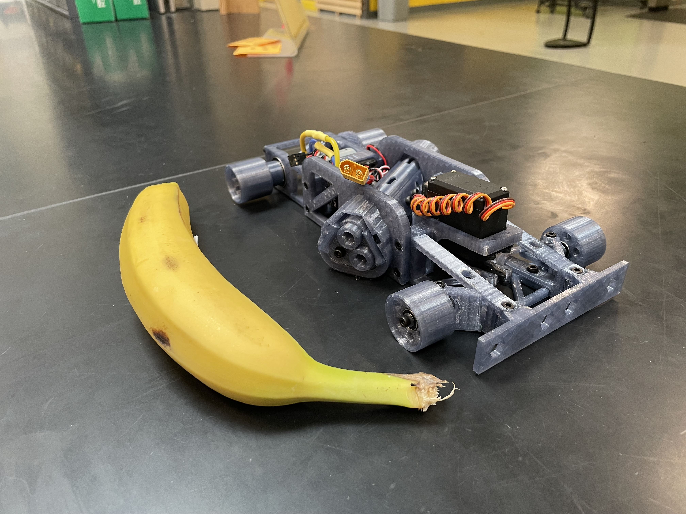
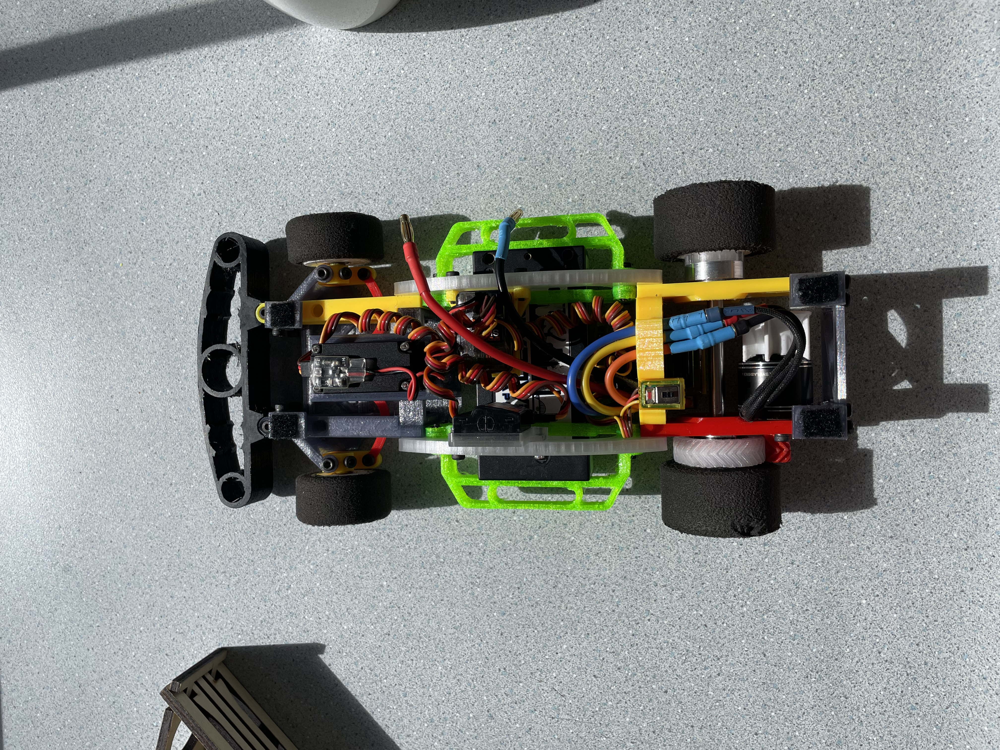
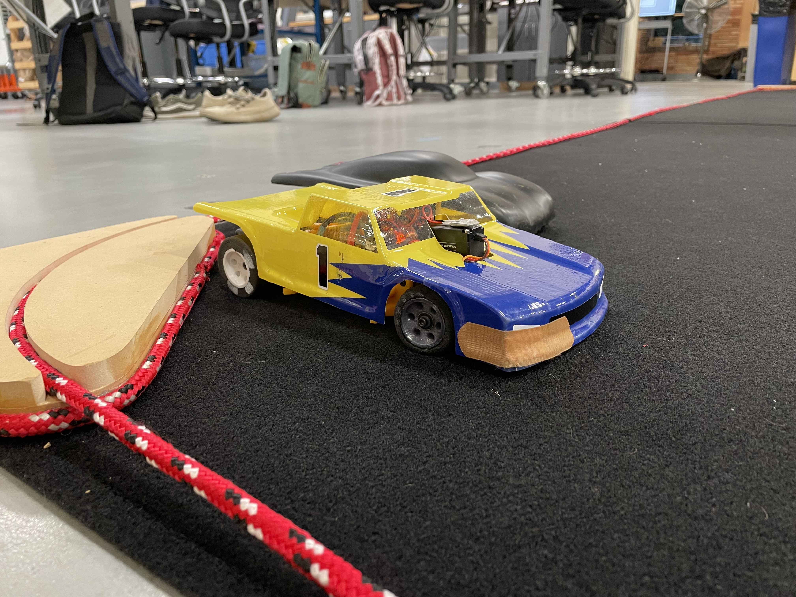
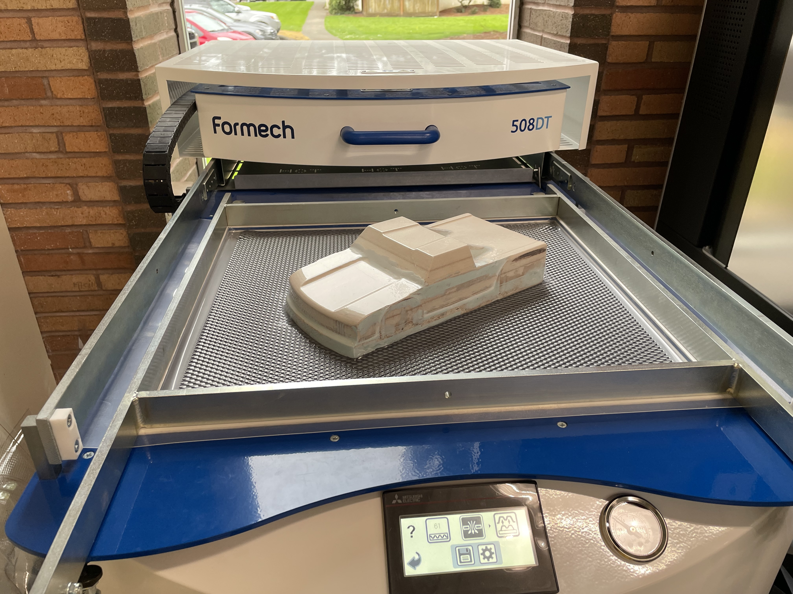
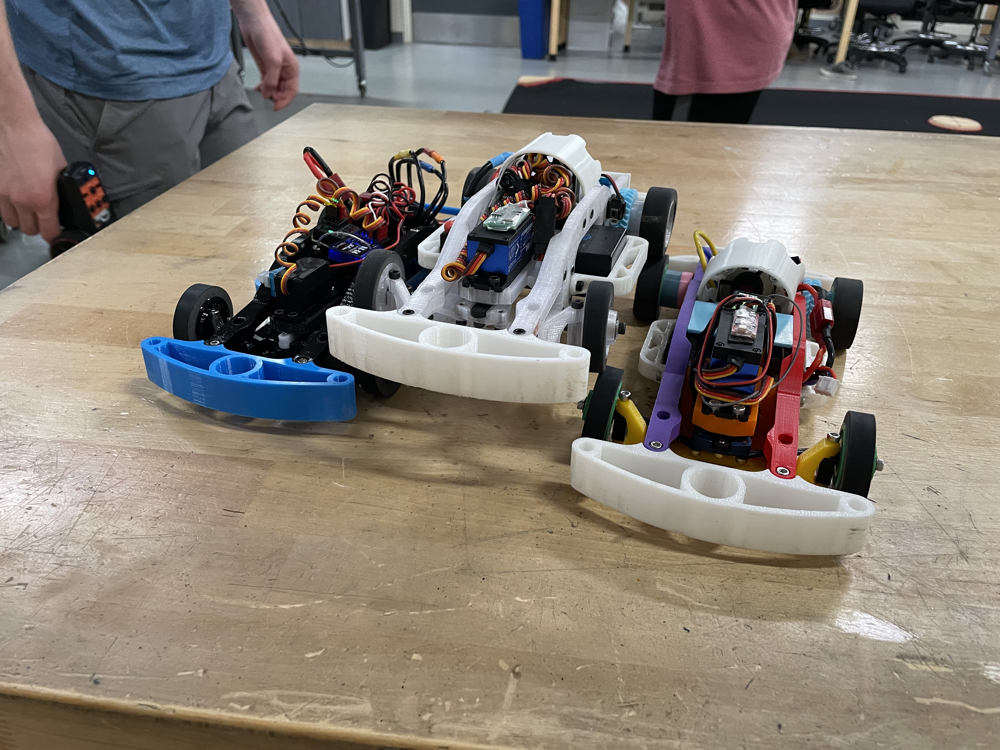
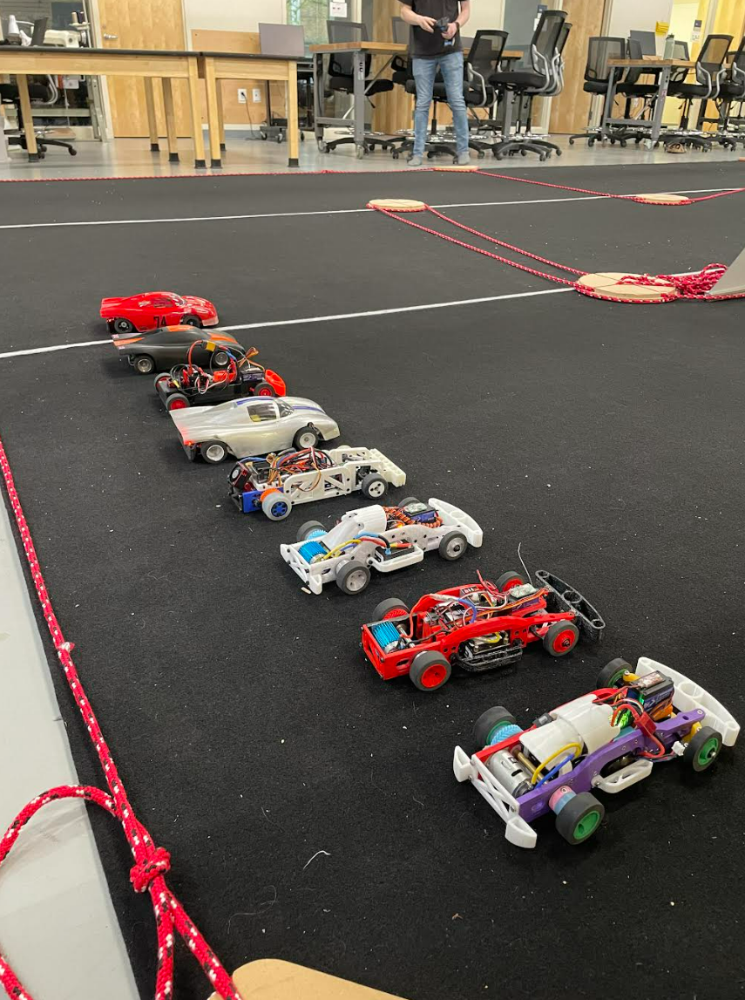

This fully 3D-printed chassis for the Formula Fox Racing Club (FFRC) focuses on accessibility without sacrificing performance.

Designed in SolidWorks, this version utilizes the tried and true dimensions of the previous car while using equation-based dimensions to allow easy modification to fit the club's open source format.

_Experimental stagger-tooth herringbone gears eliminate the need for a set screw on the pinion D-shaft._

I've integrated a suspended battery mount which reduces vibrations, enabling smooth acceleration and consistent cornering. The design also features an insulative wooden insert to prevent the printed plastic from deforming due to running an affordable brushed motor powertrain.

_Cooling off after some hot laps._

So far, the handling has been extremely reliable and the lap times are up with the quickest racers in the club. I love how this design provides a simple and affordable entry level chassis option to those who want to build a car.

_My rear motor, rear wheel drive format has seen many changes over the years!_

_Old 1.1 test platform, the quickest and most colorful car at the track._

_These vacuum formed bodies recieve a beating with my driving skills._

_Vacuum forming a body with my CNC'd MDF form._

_Club members had great success using my 1.2 design files!_

_The club lineup._

## Unique Features
* Suspended battery mount absorbs vibrations
* Anti-ackermann steering
* 40/60 weight distribution with 10mm and 15mm staggered tire setup

## What I Learned
I grew a lot in my solid modeling skills from this project, including file organization and patiently solving updates in the SolidWorks feature timeline. I used multi-body design for my car versions, but everything still needs to be immaculately organized if others are going to reference the files, or even when I come back to make changes after a few months.

From my time participating in and helping host the FFRC, the biggest innovations we've seen are the use of steering stability gyros, upgrading tires from foam to a more durable latex rubber, and the stability given from a rear weight biased design. It's been such a pleasure making friends and helping each other grow in our designing and racing skills.