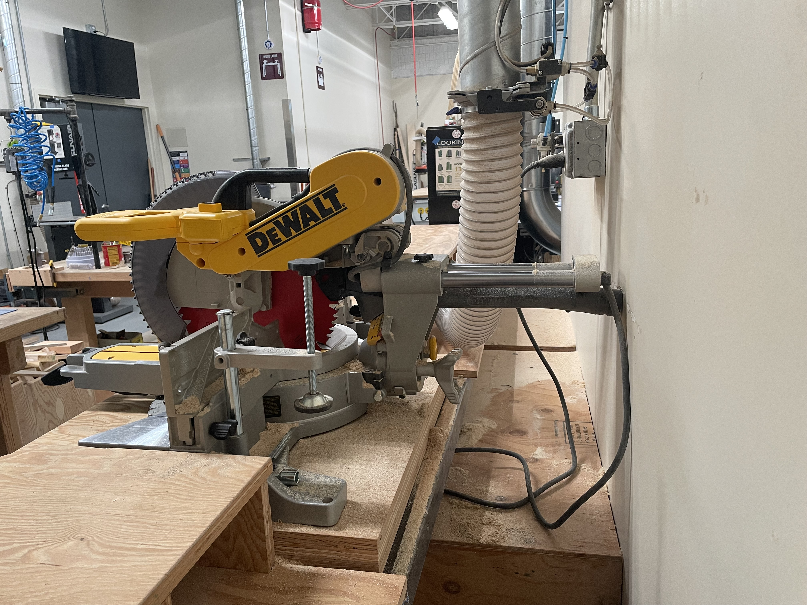
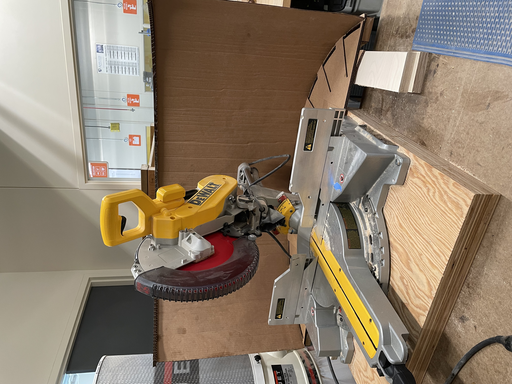
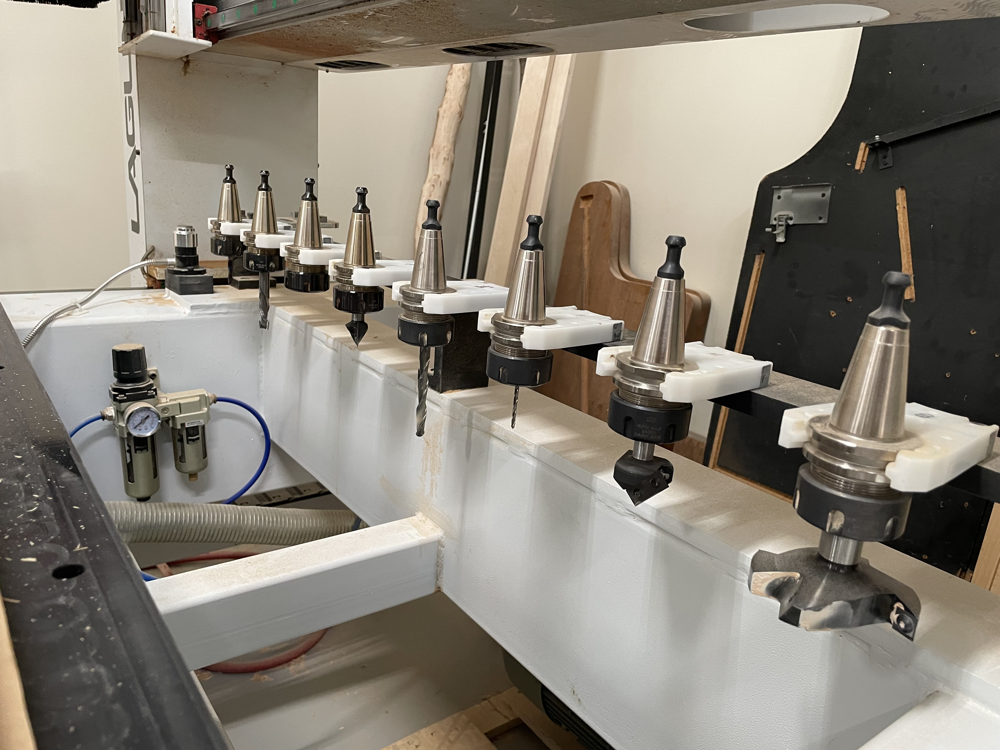
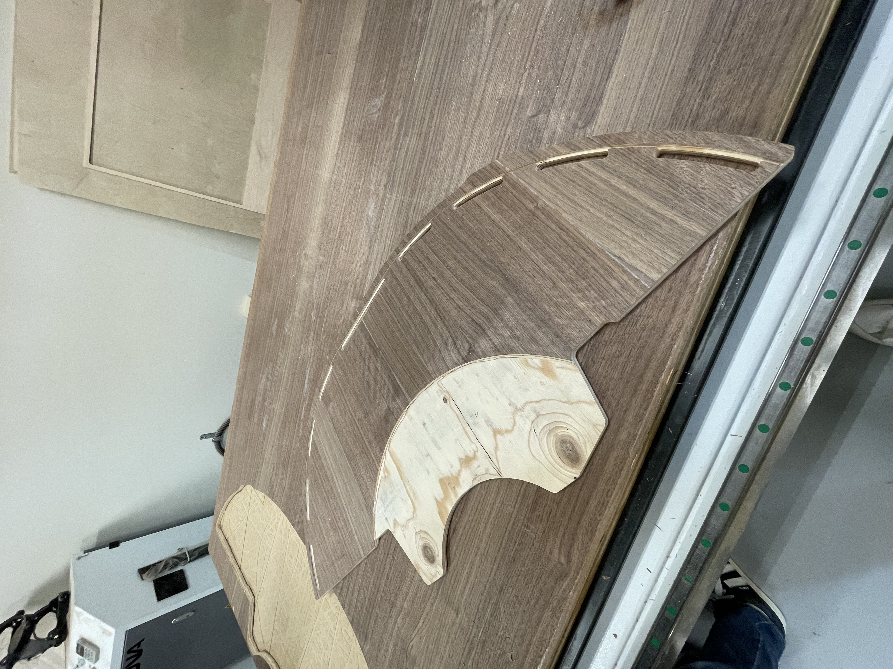
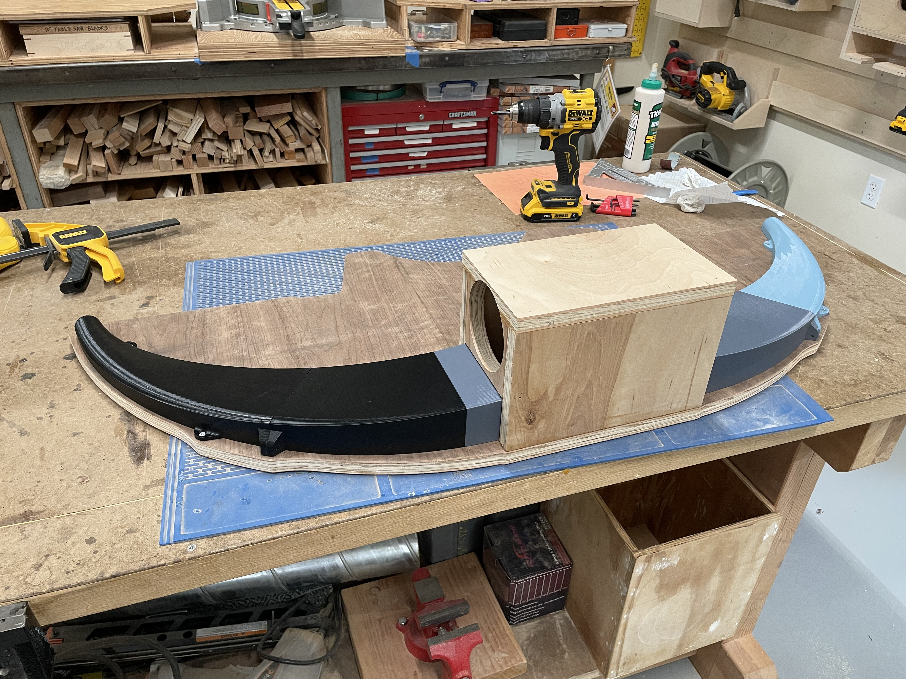
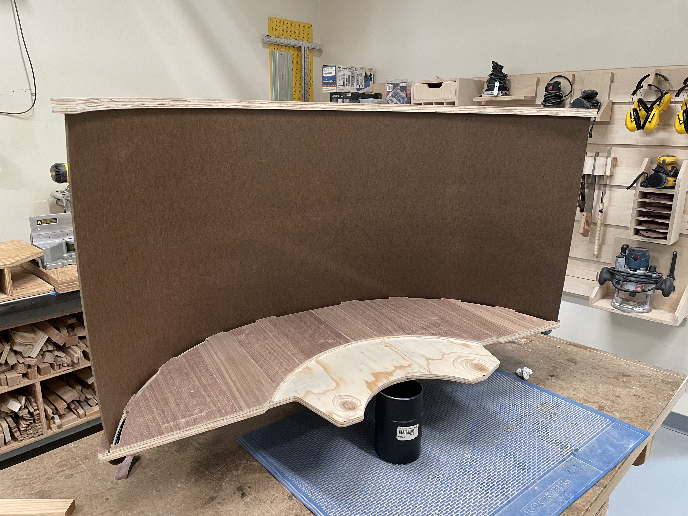
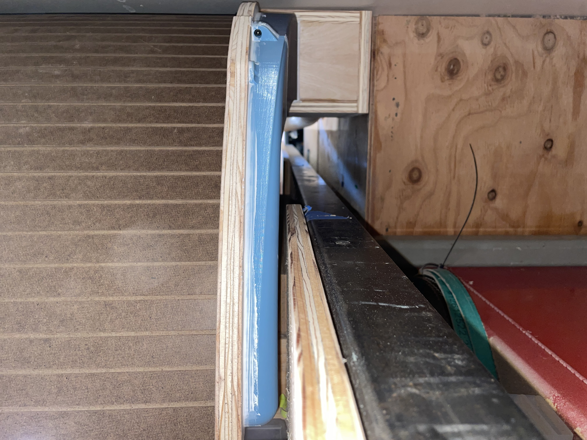

Over the summer, I had the pleasure of working at the engineering Maker Hub at George Fox. A need had by the woodshop volunteers and the engineering faculty was a good dust collection/suppression attachment that would make the most of the existing central vacuum.

I did a little market research, and all of the existing products were either too big for the space, unsightly,  or unable to work with a sliding compound miter saw. My goal was to make something that was effective, cool, and wouldn't impede anyone's woodworking experience.

_The original situation (after a thorough cleanup!)_

Since I had access to the Laguna CNC router, the sky was the limit as far as design goes, but I didn't want to waste any $$ (or woodshop scraps!) on a failed prototype. My close friend/coworker and I tore down some old boxes to laser cut and hot glue this massive prototype.

_Testing the greatest cardboard prototype I have ever made._

_Getting the tools programmed correctly in VCarve._

_The main deck CNC routed, done with two tool changes and three different tools._

_3D printed ducts work great with the tight allotted space._

_Miter saw dust collector ready for install._

_With just millimeters to spare!_

## What I Learned
The high fidelity dream was to make the vacuum ducts on each wing out of thin, lasercut steel. However, if 3D printed ducts can work just as well, why not? These ducts were the largest prints I have done in a long time, and I learned the hard way that PETG can deform in a non-ventilated enclosure.

I gained a lot of experience using the CNC router and working with VCarve, including programming pockets, facing operations, tool changes, and the nuances with piercing using compression bits.